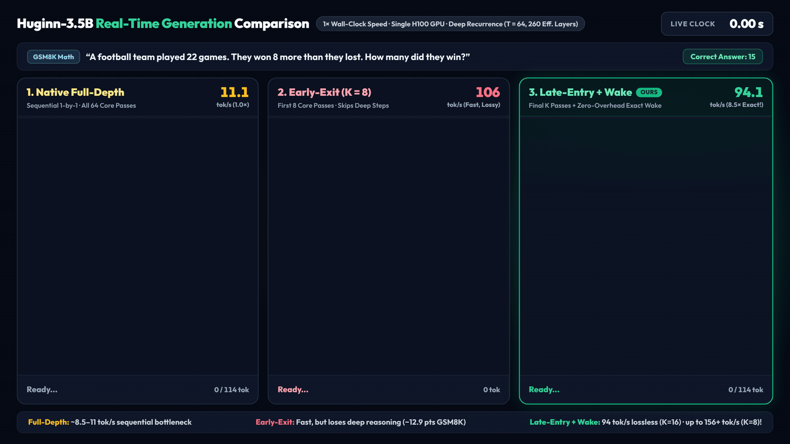
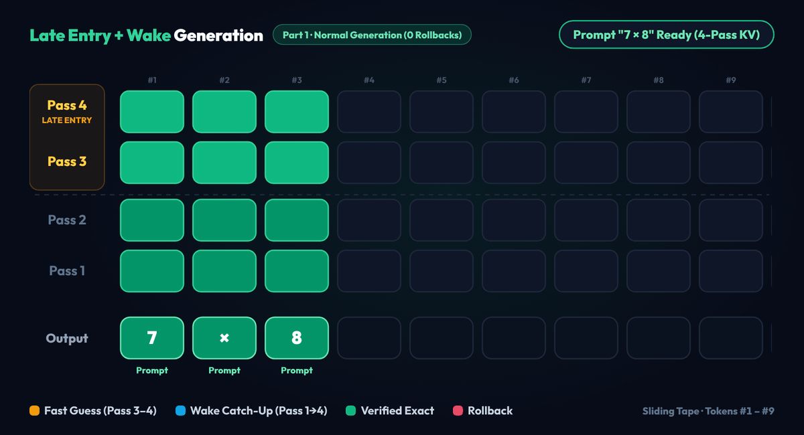

<div align="center">

# Late Entry in Looped Language Models

[](https://arxiv.org/abs/2611.24576)
[](https://xalp.net/late-entry/)
[](https://huggingface.co/collections/Xalphinions/late-entry)
[](LICENSE)

**Ziqi Jin**<sup>1</sup> · **Jiaxi Li**<sup>2</sup> · **Weiwen Xu**<sup>3,†</sup> · **Aixin Sun**<sup>1,†</sup>

<sup>1</sup>Nanyang Technological University &nbsp;·&nbsp; <sup>2</sup>Singapore University of Technology and Design &nbsp;·&nbsp; <sup>3</sup>The Chinese University of Hong Kong

[**Paper (arXiv:2611.24576)**](https://arxiv.org/abs/2611.24576) &nbsp;|&nbsp; [**Interactive Wake Studio**](https://xalp.net/late-entry/#how-it-works) &nbsp;|&nbsp; [**Checkpoints**](https://huggingface.co/collections/Xalphinions/late-entry) &nbsp;|&nbsp; [**Quickstart**](#quickstart) &nbsp;|&nbsp; [**Full Reproduction**](#end-to-end-paper-reproduction)

<br>



<sub><b>1&times; Real-Time Generation on Huginn-3.5B (Single H100):</b> Native full-depth sequential decoding stutters word-by-word (<code>11.1 tok/s</code> at <i>T</i>=64; <code>~8.5 tok/s</code> in eager PyTorch), shallow early exit (<i>K</i>=8) breaks multi-step algebra (<code>&minus;12.9 pts</code> GSM8K), and <b>Late-Entry + Exact Wake</b> finishes <b>8.5&times; faster</b> (<code>94.1 tok/s</code> lossless; up to <code>156+ tok/s</code> at <i>K</i>=8) with 100% greedy-exact output.</sub>

</div>

---

## Core Idea: Deep Cached Context Substitutes for Skipped Token-Local Passes

Looped language models deepen reasoning at a compact parameter count by iterating a shared Transformer stack $T$ times per token, turning recurrence depth directly into sequential latency. When restricting each new token to a smaller budget of $K < T$ serial passes:

* **Conventional Early Exit (`First K Passes`):** Halts after pass $K$ without cache completion, truncating cached key-value (KV) states of past tokens to shallow depth and starving all subsequent tokens of deep context.
* **Late Entry (`Final K Passes`, Ours):** Skips the initial $T - K$ passes and injects each new token directly into the **final $K$ passes** over a **full-depth $T$-pass context KV cache**.

Once lightweight two-stage fine-tuning resolves hidden-state norm mismatch at the entry boundary, **attending to $T$-pass context compensates for skipped token-local passes**, outperforming matched early exit across both purely looped **Ouro-1.4B / Ouro-2.6B ($T = 4$)** and middle-recurrent **Huginn-3.5B ($T \in \{8, 16, 32, 64\}$)**.

### Converged Single-CUDA-Graph Pipeline (`Late Entry + Pipelined Cache + Wake Verification`)

<p align="center">
  
</p>

```text
  Step s (One Static CUDA Graph = K Serial Recurrent Forward Calls on GPU)
  ┌───────────────────────────────────────────────────────────────────────────────────────────┐
  │ 1. CRITICAL PATH (Final K Passes: T-K+1 .. T)                                             │
  │    (1 + B)^2 token + mask-placeholder block attends to T-pass verified prefix             │
  │    + provisional late KV  ──►  emits tentatively accepted frontier                        │
  ├───────────────────────────────────────────────────────────────────────────────────────────┤
  │ 2. PIPELINED CACHE COMPLETION (Zero Extra Serial Calls)                                   │
  │    Prior tentative token groups ride along as piggybacked batch rows inside the same K    │
  │    calls (M_j <= 99 << 348 H100 ridge rows/pass) to build exact causal 1 -> T KV caches   │
  ├───────────────────────────────────────────────────────────────────────────────────────────┤
  │ 3. SAME-GEMM WAKE VERIFICATION (Continuous Tolerance Spectrum tau in [0, inf])            │
  │    Finished T-pass wake states share the existing lm_head output GEMM:                    │
  │      • tau = 0    (Exact Wake):  greedy-exact to T-pass sequential decoding (Prop. 1)     │
  │      • tau > 0    (Margin Wake): suppresses benign near-tie rollbacks within margin tau   │
  │      • tau = inf  (Lossy Fast):  zero-rollback maximum-throughput late-entry frontier     │
  └───────────────────────────────────────────────────────────────────────────────────────────┘
```

> **Interactive Walkthrough:** Explore token-by-token Wake promotion, HBM ridge batch packing, and $\tau$-gated rollback recovery in our [**Interactive CUDA-Graph Animation Studio**](https://xalp.net/late-entry/#how-it-works).

---

## Highlights & Main Results (`Single NVIDIA H100 80GB, bf16, B = 8`)

### 1. Unified Wake Verification Spectrum (`Paper Table 7`)

`rb` denotes Wake rollbacks per 100 emitted tokens; `(+X%)` reports incremental wall-clock throughput over same-job $K = T$ full-depth block decoding.

| Model | Benchmark | Budget | Seq. $T$ (`tok/s`) | $K = T$ Block | Exact Wake ($\tau = 0$, Greedy-Exact) | `rb` | Margin Wake ($\tau > 0$) | `rb` | Lossy ($\tau = \infty$) |
| :--- | :--- | :---: | :---: | :---: | :---: | ---: | :---: | ---: | :---: |
| **Ouro-2.6B** ($T=4$) | **GSM8K** | $K = 3$ | `.868` (`62.3`) | `.867` (`4.13×`) | **`.867` (`4.19×`, `+2%`)** | `1.14` | **`.870` (`.25`, `4.55×`, `+10%`)** | `0.29` | `.853` (`5.18×`) |
| **Ouro-2.6B** ($T=4$) | **GSM8K** | $K = 2$ | `.868` (`62.3`) | `.867` (`4.13×`) | **`.867` (`5.20×`, `+26%`)** | `2.02` | **`.877` (`.15`, `5.52×`, `+34%`)** | `1.26` | `.842` (`6.82×`) |
| **Ouro-2.6B** ($T=4$) | **MATH500** | $K = 2$ | `.532` (`62.7`) | `.526` (`4.08×`) | **`.526` (`5.23×`, `+28%`)** | `2.11` | **`.548` (`.30`, `5.83×`, `+43%`)** | `0.96` | `.492` (`6.61×`) |
| **Ouro-2.6B** ($T=4$) | **IFEval** | $K = 2$ | `.732` (`63.8`) | `.739` (`2.15×`) | **`.739` (`2.66×`, `+24%`)** | `5.98` | `.719` (`.15`, `2.94×`, `+36%`) | `4.08` | `.699` (`3.76×`) |
| **Ouro-2.6B** ($T=4$) | **MBPP** | $K = 2$ | `.616` (`63.4`) | `.626` (`3.79×`) | **`.626` (`4.61×`, `+22%`)** | `2.00` | **`.618` (`.30`, `5.13×`, `+35%`)** | `0.70` | `.602` (`6.20×`) |
| **Huginn-3.5B** ($T=32$) | **GSM8K** | $K = 16$ | `.391` (`21.9`) | `.394` (`3.35×`) | **`.396` (`5.21×`, `+56%`)** | `0.48` | **`.404` (`.25`, `5.42×`, `+62%`)** | `0.05` | `.399` (`5.80×`) |
| **Huginn-3.5B** ($T=32$) | **GSM8K** | $K = 8$ | `.391` (`21.9`) | `.394` (`3.35×`) | **`.392` (`6.09×`, `+82%`)** | `2.22` | **`.397` (`.25`, `7.15×`, `+114%`)** | `0.88` | `.353` (`9.13×`) |
| **Huginn-3.5B** ($T=32$) | **IFEval** | $K = 16$ | `.560` (`21.5`) | `.547` (`2.91×`) | **`.547` (`4.85×`, `+66%`)** | `0.37` | **`.560` (`.25`, `5.10×`, `+75%`)** | `0.02` | `.562` (`5.21×`) |
| **Huginn-3.5B** ($T=32$) | **IFEval** | $K = 8$ | `.560` (`21.5`) | `.547` (`2.91×`) | **`.556` (`6.46×`, `+122%`)** | `2.03` | `.543` (`.25`, `7.59×`, `+161%`) | `0.59` | `.542` (`8.85×`) |
| **Huginn-3.5B** ($T=32$) | **MBPP** | $K = 16$ | `.234` (`21.9`) | `.236` (`4.47×`) | **`.236` (`6.64×`, `+49%`)** | `0.25` | **`.234` (`.25`, `6.79×`, `+52%`)** | `0.03` | `.232` (`7.80×`) |
| **Huginn-3.5B** ($T=32$) | **MBPP** | $K = 8$ | `.234` (`21.9`) | `.236` (`4.47×`) | **`.236` (`7.69×`, `+72%`)** | `1.41` | **`.236` (`.25`, `8.93×`, `+100%`)** | `0.56` | `.228` (`12.50×`) |

### 2. Intra-Model Recurrence Scaling on Huginn-3.5B ($T \in \{8, 16, 32, 64\}$, `Paper Table 8`)

Evaluating the **exact same** Huginn-3.5B checkpoint across $T \in \{8, 16, 32, 64\}$ (`36 -> 260` effective layers/token on full GSM8K, $n = 1,319$):

| Recurrence Depth | Seq. $T$ (`tok/s`) | $K = T$ Block | $K = T/4$ Rollbacks / 100t | Exact Wake ($\tau = 0$) | Margin Wake ($\tau = 0.25$) | Lossy ($\tau = \infty$) |
| :--- | :---: | :---: | :---: | :---: | :---: | :---: |
| **$T = 8$** (`36L`) | `.262` (`54.7`) | `2.86×` | `12.46` | `.262` (`1.96×`, `+23.2 pts` recovery) | `.259` (`2.16×`) | `.030` (`4.82×`) |
| **$T = 16$** (`68L`) | `.381` (`36.9`) | `3.32×` | `6.25` | **`.380` (`3.47×`, `+5%`)** | **`.380` (`4.41×`, `+33%`)** | `.321` (`6.56×`) |
| **$T = 32$** (`132L`) | `.391` (`21.9`) | `3.35×` | `2.22` | **`.392` (`6.09×`, `+82%`)** | **`.397` (`7.15×`, `+114%`)** | `.353` (`9.13×`) |
| **$T = 64$** (`260L`) | `.400` (`12.1`) | `3.34×` | **`0.58` (`21.5×` lower)** | **`.400` (`8.42×`, `+153%`)** | **`.403` (`9.17×`, `+175%`)** | **`.392` (`10.57×`)** |

### 3. Six-Benchmark Non-Rollback Suite & Speculative Baselines (`Paper Tables 3, 5, 6`)

Across `21,403` examples on Ouro-2.6B (`GSM8K`, `IFEval`, `MATH500`, `MBPP`, `BBH`, `MMLU-Pro`), full-depth $K = 4$ block decoding reaches `2.12×` to `4.11×` (outpacing `LoopSpec` at `2.34×` to `2.86×` and `LoopAhead` at `2.44×` to `3.25×` on 5 of 6 tasks), while late entry pushes throughput to **`2.82×` to `5.09×`** at $K = 3$ (`+23%` to `+31%` over $K = 4$) and **`3.78×` to `6.73×`** at $K = 2$ (`+59%` to `+87%`). Against matched trained early exit (`Paper Table 4`), late entry leads by **`+16.9` points** on Ouro-2.6B GSM8K at `~430 tok/s` ($p = 2.7 \times 10^{-35}$) and **`+9.7` points** on 32-pass Huginn-3.5B at `~220 tok/s` (`9.93×`).

---

## Released Checkpoints ([Hugging Face Collection](https://huggingface.co/collections/Xalphinions/late-entry))

All checkpoints include model weights, tokenizer, and standalone configuration:

| Checkpoint | Base Model | Architecture | Paper Role |
| :--- | :--- | :--- | :--- |
| [`Xalphinions/ouro-2.6b-late-entry`](https://huggingface.co/Xalphinions/ouro-2.6b-late-entry) | `ByteDance/Ouro-2.6B` | Purely looped ($T = 4$, 48 layers) | Main Ouro late-entry & Wake model (Sec. 2–4.7) |
| [`Xalphinions/ouro-2.6b-early-exit`](https://huggingface.co/Xalphinions/ouro-2.6b-early-exit) | `ByteDance/Ouro-2.6B` | Purely looped ($T = 4$, 48 layers) | Matched Stage-2 early-exit control (Sec. 2.3, 4.2) |
| [`Xalphinions/ouro-1.4b-late-entry`](https://huggingface.co/Xalphinions/ouro-1.4b-late-entry) | `ByteDance/Ouro-1.4B` | Purely looped ($T = 4$, 24 layers) | 1.4B scale-replication late-entry model (Sec. 2.2–2.3) |
| [`Xalphinions/huginn-3.5b-late-entry`](https://huggingface.co/Xalphinions/huginn-3.5b-late-entry) | `tomg-group-umd/huginn-0125` | Prelude-Core-Coda ($T \in \{8..64\}$) | Main Huginn late-entry & Wake model (Sec. 4.4–4.6) |
| [`Xalphinions/huginn-3.5b-early-exit`](https://huggingface.co/Xalphinions/huginn-3.5b-early-exit) | `tomg-group-umd/huginn-0125` | Prelude-Core-Coda ($T = 32$) | Matched 32-pass early-exit control (Sec. 4.4, App. H) |

---

## Repository Map

| Directory | Paper Sections | Contents |
| :--- | :--- | :--- |
| [`wake_verify/`](wake_verify/) | **Sec. 3.4, 4.5–4.7** | **Unified Wake Verification ($\tau \in [0, \infty]$)** for Ouro (`ouro_wake.py`) & Huginn $T \in \{8..64\}$ (`hg_wake.py`), suffix-ngram drafter (`suffix_draft.py`), Physical Roofline Law (`analyze_roofline_v8.py`), `258/258` `fp64` CPU exactness gates, and full JSON results |
| [`decode/`](decode/) | Sec. 3.1–3.3, 4.1–4.2, App. E–F | Standalone paged FlashAttention-3 / CUDA-graph looped inference engine (`engine.py`), $K$-pass late-entry (`lk:`), no-catch-up (`lknb:`), restart-repair (`lkdb:`), and early-exit (`eeblk:`) block decoders (`latek.py`, `run_latek.py`) |
| [`huginn/`](huginn/) | Sec. 4.4, 4.6, App. H | **Huginn-3.5B ($T = 32$) adaptation & CUDA-graphed paged FA3 engine** (`hg_fast_dec.py`), Stage-1/Stage-2 trainers, single/block decoders, formal scorers, `128/128` CPU gates, and evaluation tables |
| [`train/`](train/) | Sec. 2.1, App. A–B | Two-stage Ouro fine-tuning (`train_ar_sft.py`, `train_mars.py`, matched control `train_mars_firstt.py`), explicit late-lattice distillation (`late_lattice/`), and vendored `dllm/` + `mars/` packages |
| [`concurrency/`](concurrency/) | Sec. 4.7, 6, App. I | Multi-request continuous batching ($C = 1 \dots 32$) `LateKBatchExecutor` (`batch_latek.py`, `2.31×` decode / `1.67×` e2e at $C = 32$), **SGLang 0.5.14 Spec-V2 plugin** (`sglang_late/`), and `546` CPU gates |
| [`eval/`](eval/) | Sec. 4.1, App. E, G | Six-benchmark prompt materialization (`materialize_x.py`, `prep_x.py`), gold-verified `GSM8K`, `IFEval`, `MATH500`, `MBPP`, `BBH`, `MMLU-Pro` scorers, and full-test-set summaries |
| [`baselines/`](baselines/) | Sec. 4.3, App. G | Full-depth ($T = 4$) speculative decoding runners for **LoopSpec** (`loopspec/`) and **LoopAhead** (`loopahead/`), plus 21,403-example head-to-head pooling (`make_headtohead_full.py`) |
| [`probes/`](probes/) | Sec. 2.1–2.3, App. C | Off-the-shelf hidden-state norm mismatch diagnostics & frozen linear/MLP entry adapters (`entry/`) plus $(D, K)$ decoupling, cross-pass $(K, V)$ swap, and confidence probes (`mechanism/`) |
| [`tests/`](tests/) | Sec. 3.3–3.4, App. D | One-command deterministic CPU verification suite (`run_all_cpu_tests.py`) and independent step-by-step HF reference implementations (`ref_late.py`, `ref_late_k.py`) |
| [`project_page/`](project_page/) | Web | Standalone interactive project webpage (`index.html`) with live CUDA-graph & Wake animation |

---

## Quickstart

### Installation

```bash
git clone https://github.com/Xalp/LateComer.git
cd LateComer
pip install -r requirements.txt

# Optional (recommended for single-H100 CUDA-graphed paged FlashAttention-3 speedups):
pip install sgl-kernel==0.4.4 flashinfer-python==0.6.12 triton>=3.1.0
```

### 1. Instant CPU Exactness & Roofline Verification (`No GPU Required, ~45s`)

Verify **Proposition 1** (`258/258` `fp64` adversarial Wake exactness & EOS wake-drain tests across Ouro and Huginn), Huginn paged-KV fast-engine equivalence (`128/128` checks), $K$-pass late-entry & multi-request continuous-batching KV invariants, and the zero-shot $L_p$ Roofline law (`8.3%` MAPE, `11/12` $B^\star(C)$ match):

```bash
python tests/run_all_cpu_tests.py
```

### 2. Ouro-2.6B ($T = 4$) Wake Verification & Late-Entry Decoding

```bash
# Tokenize zero-shot chat prompts once (shared across all decoders)
python eval/prep_x.py --model Xalphinions/ouro-2.6b-late-entry --task gsm8k

# Run Sequential (ar), Full Block (K=4), Exact Wake (tau=0), Margin Wake (tau=0.15/0.30), and Lossy (tau=inf)
python wake_verify/run_ouro_wake.py \
  --model Xalphinions/ouro-2.6b-late-entry \
  --prompts eval/data/gsm8k_prompts.jsonl \
  --modes "ar,lk:4:latt:8,wk:2:latt:8:0,wk:2:latt:8:0.15,wk:2:latt:8:0.3,lk:2:latt:8" \
  --max-new 1024 \
  --out results/ouro_wake_gsm8k.json
```

### 3. Huginn-3.5B ($T \in \{8, 16, 32, 64\}$) Wake Verification & Depth Scaling

```bash
# Run Unified CUDA-Graphed Paged FA3 Wake Decoder at T = 32 (pass --T 8 / 16 / 64 for Table 8 scaling)
PYTHONPATH=. python -m wake_verify.hg_wake \
  --model Xalphinions/huginn-3.5b-late-entry \
  --T 32 \
  --tasks data/tasks/gsm8k.jsonl \
  --cfgs "blk:32:0,blk:32:8,wblk:16:8:0,wblk:16:8:0.25,blk:16:8,wblk:8:8:0,wblk:8:8:0.25,blk:8:8" \
  --max-new 512 \
  --out-dir results/huginn_wake_t32
```

---

## End-to-End Paper Reproduction

1. **Two-Stage Fine-Tuning (`Sec. 2.1, App. A, H`):**
   * **Ouro-2.6B / 1.4B:** Run Stage-1 full-depth SFT (`train/train_ar_sft.py`) followed by Stage-2 late-entry block fine-tuning (`train/train_mars.py`) or matched early-exit Stage-2 (`train/train_mars_firstt.py`) on `allenai/Dolci-Instruct-SFT` (1 epoch each, max length `1,024`, global batch `256`). Full commands in [`train/README.md`](train/README.md).
   * **Huginn-3.5B ($T = 32$):** Run `huginn/train/train_hg_stage1.py` followed by `huginn/train/train_hg_stage2.py` (late entry) or `huginn/train/train_hg_stage2_early.py` (matched early exit). Full commands in [`huginn/README.md`](huginn/README.md).
2. **Entry Norm Mismatch & Internal Mechanism Probes (`Sec. 2.1–2.3, App. C`):**
   * Reproduce Table 1 frozen adapters (`probes/entry/`) and Figure 2 $(D, K)$ context-vs-token depth decoupling, cross-pass $(K, V)$ swaps, and confidence localization (`probes/mechanism/`). Details in [`probes/README.md`](probes/README.md).
3. **Six-Benchmark Suite & Speculative Baselines (`Sec. 4.1–4.3, App. G`):**
   * Materialize and score `GSM8K`, `IFEval`, `MATH500`, `MBPP`, `BBH`, and `MMLU-Pro` via [`eval/`](eval/), run non-rollback $K \in \{4, 3, 2\}$ sweeps via [`decode/run_latek.py`](decode/), and run `LoopSpec` / `LoopAhead` head-to-head comparisons via [`baselines/`](baselines/).
4. **Multi-Request Continuous Batching & SGLang Serving (`Sec. 4.7, 6, App. I`):**
   * Benchmark $C \in \{1, 2, 4, 8, 16, 32\}$ saturated serving with adaptive $B^\star(C) \in \{8, 4, 2\}$ (`concurrency/bench_concurrency.py`) or launch the token-identical SGLang 0.5.14 Spec-V2 server (`PYTHONPATH=concurrency python -m sglang_late`). Details in [`concurrency/README.md`](concurrency/README.md).

---

## Citation

```bibtex
@article{jin2026lateentry,
  title   = {Late Entry in Looped Language Models},
  author  = {Jin, Ziqi and Li, Jiaxi and Xu, Weiwen and Sun, Aixin},
  journal = {arXiv preprint arXiv:2611.24576},
  year    = {2026},
  url     = {https://arxiv.org/abs/2611.24576}
}
```

## License

Code in this repository is released under the [MIT License](LICENSE). Base model weights (`Ouro-1.4B`, `Ouro-2.6B`, `Huginn-0125`) and evaluation datasets retain their respective upstream licenses.
